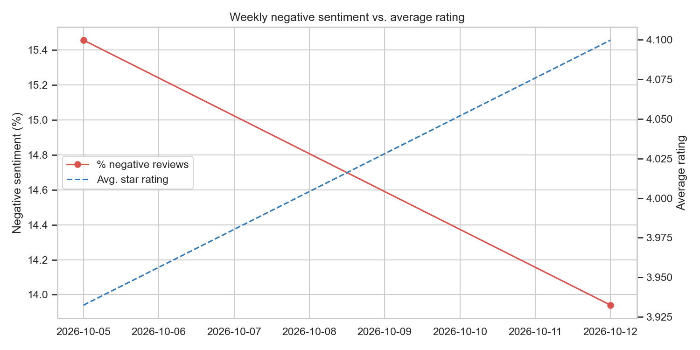
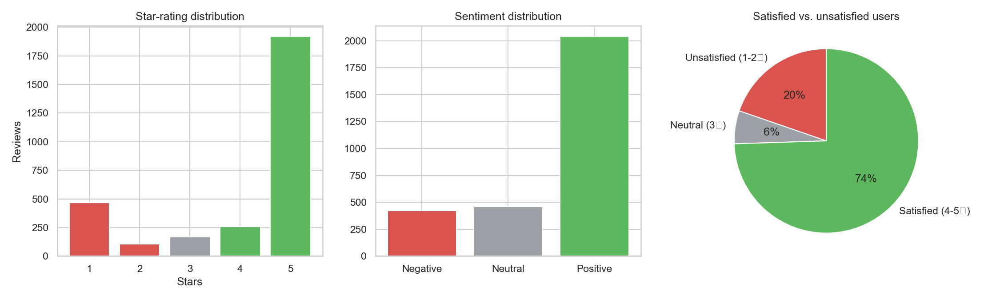

# App Review Insights — Extracting "Actionable Complaints" from App Store Reviews

> **Algonive Data Science Internship — Task 3**
> *How can a small software company identify the specific reasons for user frustration without manually reading thousands of app store reviews every week?*

An end-to-end NLP pipeline that scrapes Google Play reviews, cleans the text, scores sentiment, finds the most frequent complaint phrases, tags complaints into business themes, and produces a one-page **management summary** with charts.

## Pipeline

| Phase | What happens | Code |
|---|---|---|
| **A. Collection** | Scrape ≥1,000 reviews (text, star rating, date) | `src/collect.py` |
| **B. Pre-processing** | Lowercase → noise removal (emojis, `@ # $`, URLs) → stop-word removal (keeping *not/no/never*) → tokenization → lemmatization | `src/preprocess.py` |
| **C. Analysis** | Sentiment (VADER, domain-tuned), bigrams, TF-IDF word gap between 1-2★ and 4-5★ reviews, rating↔sentiment correlation, complaint-theme tagging, change-point detection | `src/analyze.py` |
| **D. Visualization** | Trend line, word cloud of pain, distribution plots, theme charts | `src/visualize.py` |

| Stage | Techniques | Tools |
|---|---|---|
| Extraction | Web scraping / API fetching | `google-play-scraper` |
| NLP | Tokenization, stop-word removal, lemmatization | NLTK |
| Analysis | Sentiment, TF-IDF, bigrams | VADER, scikit-learn |
| Storage | Data structuring | pandas |
| Reporting | Visualization, dashboard | Matplotlib, Seaborn, WordCloud, Streamlit |

## Quick start

```bash
git clone https://github.com/simrn31/app-review-insights.git
cd app-review-insights
python -m venv .venv && source .venv/bin/activate     # Windows: .venv\Scripts\activate
pip install -r requirements.txt
python -c "import nltk; [nltk.download(p) for p in ('stopwords','wordnet')]"

# Real data (needs internet) — pick any app with >= 1,000 reviews
python main.py --source play --app-id com.spotify.music --count 3000

# Offline demo with SYNTHETIC data
python main.py --source sample

# Your own CSV (columns: review_text, rating, date)
python main.py --source csv --csv my_reviews.csv --update-date 2026-08-12
```

### Interactive dashboard

```bash
streamlit run app.py
```
Pick a data source (sample, uploaded CSV, or a live Google Play app), filter by date and stars, and explore the trend, complaint themes, bigrams, word cloud and individual reviews. Filtered reviews and the management summary can be downloaded.

Run tests: `python -m pytest -q`

## Outputs

* `outputs/management_summary.md` — auto-generated findings and recommended actions
* `outputs/figures/` — `1_trend_line.png`, `2_word_cloud_of_pain.png`, `3_distribution_plot.png`, `4_top_bigrams.png`, `5_complaint_themes.png`, `6_theme_shift.png`
* `outputs/tables/` — bigrams, themes, theme shift, distinctive words, weekly trend (CSV)
* `data/processed/reviews_clean.csv` — cleaned reviews with sentiment and theme flags




## Design decisions

* **Sentiment engine: VADER** instead of TextBlob. VADER is built for short, informal text: it handles negation, intensifiers, ALL-CAPS, punctuation and emojis, so it is fed the *raw* review. A small domain lexicon (crash, laggy, paywall, overpriced...) is added. Fallback order if unavailable: NLTK's VADER, TextBlob, then a built-in lexicon. The engine used is printed and written into the summary.
* **Negations are kept** during stop-word removal so phrases like *"not working"* and *"cannot login"* survive into the bigrams.
* **Bigrams over single words**: "login fail" is actionable; "fail" is not.
* **Theme tagging** (regex over cleaned text, multi-label) converts raw text into categories a product team can assign to an owner.
* **Change-point detection** finds the week where negative sentiment shifts most; detection is at weekly resolution, so verify against your release calendar or pass `--update-date`.
* The pipeline degrades gracefully: without NLTK data / TextBlob / WordCloud it falls back to scikit-learn stop words, a built-in lexicon scorer and a bar chart.

## Limitations & next steps

* VADER is lexicon-based and still misses sarcasm. For higher accuracy, try a transformer (e.g. `cardiffnlp/twitter-roberta-base-sentiment`).
* Theme regexes are hand-written; try topic modelling (LDA/BERTopic) to discover themes automatically.
* Add a scheduled weekly run (GitHub Actions) for the "every week" requirement.

## Structure

```
app-review-insights/
├── main.py         (CLI pipeline)
├── app.py          (Streamlit dashboard)
├── requirements.txt
├── src/            collect.py · preprocess.py · analyze.py · pipeline.py · visualize.py · generate_sample_data.py
├── tests/          test_pipeline.py
├── data/           raw/ · processed/
└── outputs/        figures/ · tables/ · management_summary.md
```

## License
MIT
